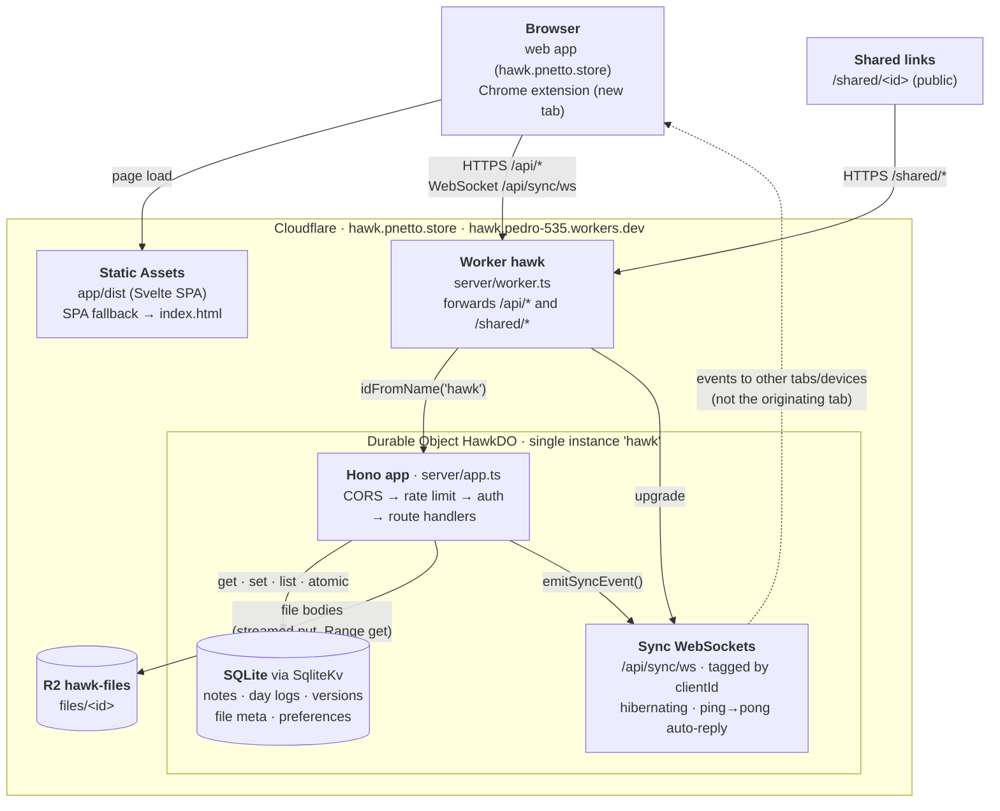
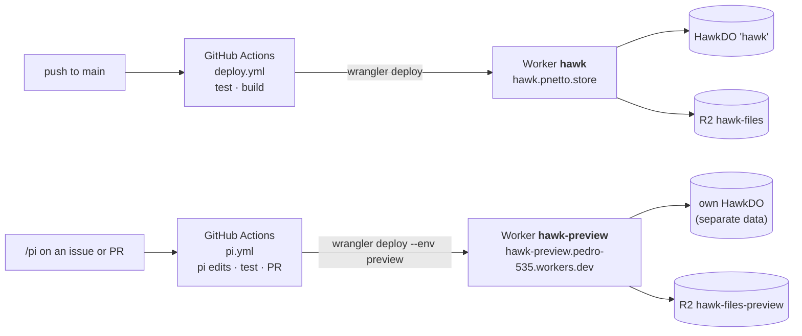

# Hawk architecture (Cloudflare)

## Preview and CI

## Notes

- **One Worker, one Durable Object.** The Worker only forwards `/api/*` and `/shared/*`; everything else is served by Static Assets without running it. The `hawk` Durable Object owns all data, runs the API and holds the sync sockets. One user means one instance, so state is consistent without extra coordination.
- **Data.** Notes, days, versions, file metadata and preferences live in the Durable Object's SQLite behind a Deno.Kv-style layer (`server/utils/sqliteKv.ts`), keeping the key layout from Deno KV. File bodies are in R2.
- **Sync.** Every mutating handler calls `emitSyncEvent()`, which pushes the event to every open socket except the originating tab's (sockets are tagged with the tab's `clientId`). Missed events aren't replayed.
- **Cost.** Each API call is one Worker request plus one Durable Object request. Idle sockets hibernate, and the runtime answers keepalive pings without waking the object.
